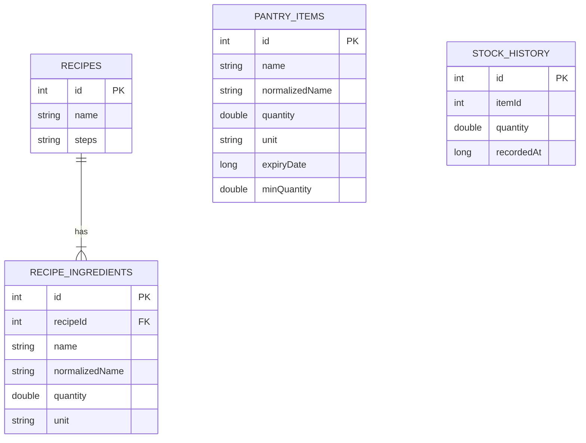
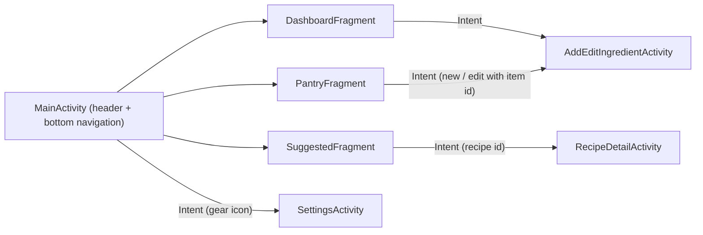

# Smart Pantry Manager

**Developed by Micaiah Nhamburo**
Mobile App Development 700 - Individual Practical Assignment

A Java Android app that helps cut food waste. You track the ingredients you actually have at home, and the app
suggests recipes you can cook using **only** those ingredients. A recipe is suggested only when *every* ingredient
it needs is in your pantry in at least the required quantity, so no shopping trip is needed.

## Screenshots

Add your own screenshots of the running app to `docs/screenshots/` and keep the file names below
(or edit the paths).

| Dashboard | Pantry | Add / Edit | Suggested Recipes | Recipe Detail |
|---|---|---|---|---|
|  |  |  |  |  |

## Features

- **Dashboard**: quick actions, inventory statistics, low-stock alert cards, expiring-soon cards and a 14-day stock history chart
- **Pantry management**: add, edit and delete ingredients (name, quantity, unit, optional expiry date, optional low-stock alert level), with input validation
- **Pantry list**: RecyclerView with a custom adapter bound live to the database, with delete confirmation and undo
- **20 pre-loaded recipes** seeded on first run
- **Suggested Recipes**: runs the strict-matching rule and lists only recipes you can make right now
- **"Almost there" list** (bonus): recipes missing exactly one ingredient, kept separate from the strict list
- **Recipe detail**: full ingredient list (tick or cross against your pantry) and numbered method
- **Stock history**: every quantity change is recorded and charted (dashboard and per-ingredient)
- **Settings**: expiring-soon alerts toggle and default unit for new ingredients
- Friendly empty-state message when no recipes match yet
- Minimalist, responsive design (phones, tablets, landscape)

The app uses no Google Maps, mapping SDK or location/GPS, and requests no permissions.

## The strict-matching rule

Implemented in `util/RecipeMatcher.java`:

1. Every recipe ingredient must be in the pantry in at least the required quantity.
   A recipe that needs 5 ingredients when the pantry has 4 is **excluded**.
2. Matching copes with simple real-world messiness:
   - names are normalised: `Tomatoes` = `tomato`, `Spaghetti` = `pasta`, `Baby marrow` = `zucchini`
   - units are converted: 1 kg covers a recipe that needs 500 g
   - several pantry entries of the same ingredient are added together
   - units of different kinds (grams vs pieces) are never compared
3. Recipes missing exactly one ingredient appear only in the separate "Almost there" list.

## Database choice: SQLite (Room)

All data is stored on the device in SQLite through the Room library. I chose it because:

- the app is single-user and works fully offline
- it needs no accounts, backend or hosting
- Room gives compile-time checked SQL and `LiveData`, so lists update automatically
- data persists after the app is closed and reopened

Tables: `pantry_items`, `recipes`, `recipe_ingredients` (foreign key to `recipes`, cascade delete) and
`stock_history`. Database version 2 added the low-stock level and the history table through a Room migration,
so existing data is kept on upgrade.



## Screen flow



## Project structure

```
app/src/main/java/com/smartpantry/app/
  data/       PantryItem, Recipe, RecipeIngredient, RecipeWithIngredients, StockHistory,
              PantryDao, RecipeDao, StockHistoryDao, PantryRepository, AppDatabase, RecipeSeeder
  util/       RecipeMatcher, IngredientNormalizer, UnitConverter, StockHistoryCalculator, TextFormat, AppPrefs
  ui/         MainActivity, DashboardFragment, PantryFragment, SuggestedFragment, SettingsFragment,
              SettingsActivity, AddEditIngredientActivity, RecipeDetailActivity, PantryAdapter, RecipeAdapter
  ui/widget/  LineChartView, ThinProgressView
app/src/test/ Unit tests (matcher, normaliser, unit converter, stock history)
```

## Setup and run

### Requirements
- Android Studio (Koala or newer) with JDK 17 (bundled) and Android SDK 34
- An emulator (API 24+) or an Android phone with USB debugging enabled

### Option 1: Android Studio
1. Clone the repository: `git clone <your-repo-url>`
2. Open the project folder in Android Studio and wait for Gradle sync to finish.
3. Choose an emulator or connected phone and press **Run**.

### Option 2: Command line (Windows `cmd`)
```
cd path\to\SmartPantryManager
echo sdk.dir=C\:\\Android> local.properties
gradle wrapper --gradle-version 8.7

gradlew.bat test
gradlew.bat assembleDebug

adb devices
gradlew.bat installDebug
adb shell am start -n com.smartpantry.app/.ui.MainActivity
```
Change `C\:\\Android` to your Android SDK folder. The debug APK is created at
`app\build\outputs\apk\debug\app-debug.apk`.

### Run the unit tests
`gradlew.bat test` (or right-click `app/src/test` in Android Studio and choose **Run Tests**).

## Try the strict matching

1. Open **Pantry** and add Bread 2 piece and Cheese 100 g. The **Recipes** tab shows the empty-state message.
2. Add Butter 50 g. *Cheese Toastie* appears under **Ready to cook**.
3. Delete Butter. *Cheese Toastie* disappears (and moves to **Almost there**).

## Try the dashboard

1. Add Rice 300 g with a low-stock alert level of 500. It appears under **Low stock alert!**.
2. Add Milk with an expiry date two days away. It appears under **Time for your next check-in!**.
3. Change an ingredient's quantity a few times, then open it to see its history chart.

## Author

Micaiah Nhamburo - Mobile App Development 700
