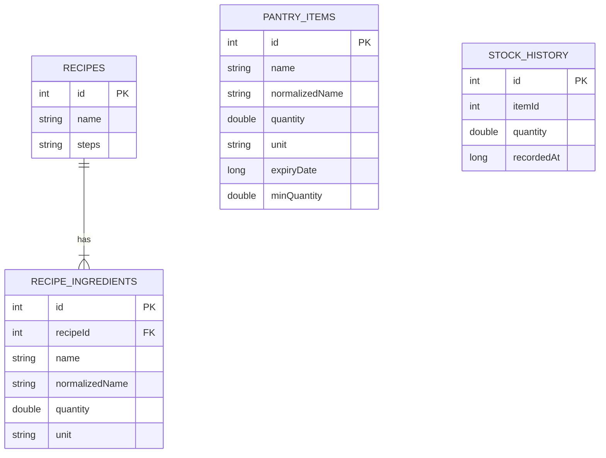
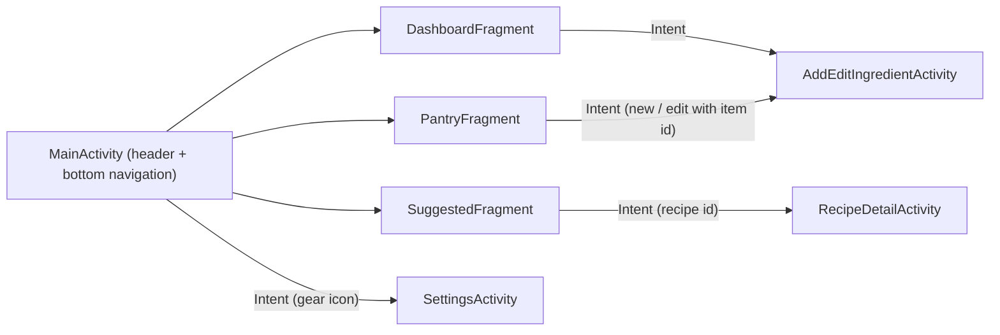

# Smart Pantry Manager

**Developed by Micaiah Nhamburo**

A Java Android app that helps reduce food waste by tracking what is in your pantry and suggesting
recipes you can cook **using only what you already have**. A recipe is suggested only when *every*
ingredient it needs is in your pantry in at least the required quantity. No shopping trip required.

Built for **Mobile App Development 700** (individual practical assignment).

## Design

A minimalist, premium look: clean white background, warm cream surfaces, soft peach accents, muted brown
icons, bold charcoal typography, rounded cards with subtle beige borders, and thin red/green progress
indicators. The layout is fluid (weights, `match_parent`, `sp` text) with larger side margins on tablets
(`values-sw600dp`), so it adapts to phones, tablets and landscape.

## Features

- **Dashboard** (home tab): quick actions, inventory statistics (total items, low stock, expiring soon,
  recipes ready), low-stock alert cards, expiring-soon cards and a 14-day stock history chart
- **Low-stock alerts**: set an optional alert level on any ingredient; when quantity falls to it, the
  item shows on the dashboard with a thin red progress bar
- **Stock history**: every quantity change is recorded; the dashboard chart shows how many ingredients
  were in the pantry each day and the edit screen shows a chart for a single ingredient
- **Pantry management**: add, edit and delete ingredients (name, quantity, unit, optional expiry date)
- **Pantry list** (RecyclerView + custom adapter) bound live to the database
- **20 pre-loaded recipes** seeded on first run
- **Suggested Recipes** screen that runs the strict-matching rule and lists only recipes you can make right now
- **Recipe detail** with the full ingredient list (tick / cross against your pantry) and numbered method
- **Settings** (gear icon): expiring-soon alerts toggle and default unit for new ingredients
- Friendly empty-state message when no recipe matches yet
- Input validation on the add/edit form
- *Bonus*: a separate **"Almost there"** list (recipes missing exactly one ingredient), clearly separated from the strict list

The app uses **no** Google Maps, mapping SDK or location/GPS, and requests **no permissions**.

## The strict-matching rule

Implemented in `util/RecipeMatcher.java`:

1. Every recipe ingredient must exist in the pantry with at least the required quantity.
   A recipe needing 5 ingredients when the pantry has 4 is **excluded**.
2. Matching is robust to simple real-world messiness:
   - names are normalised: `Tomatoes` = `tomato`, `Spaghetti` = `pasta`, `Baby marrow` = `zucchini` (`IngredientNormalizer`)
   - units are converted to a base unit: 1 kg covers a recipe that needs 500 g (`UnitConverter`)
   - several pantry entries of the same ingredient are added together
   - units from different dimensions (grams vs pieces) are never compared
3. Recipes with exactly one missing ingredient go only to the optional "Almost there" list.

## Database choice: SQLite (Room)

Room (the SQLite abstraction library) stores everything on-device in `smart_pantry.db`.
I chose it because the app is single-user and works fully offline, it needs no accounts, backend or
hosting, Room gives compile-time checked SQL and `LiveData` so lists update automatically, and data
persists after the app is closed and reopened.

Tables: `pantry_items`, `recipes`, `recipe_ingredients` (foreign key to `recipes`, cascade delete) and
`stock_history`. Database version 2 adds the low-stock level and the history table through a proper Room
migration, so existing pantry data is kept on upgrade.



## Screen flow



## Project structure

```
app/src/main/java/com/smartpantry/app/
  data/   PantryItem, Recipe, RecipeIngredient, RecipeWithIngredients, PantryDao, RecipeDao,
          StockHistory, StockHistoryDao, PantryRepository, AppDatabase, RecipeSeeder
  util/   RecipeMatcher, IngredientNormalizer, UnitConverter, StockHistoryCalculator, TextFormat, AppPrefs
  ui/     MainActivity, DashboardFragment, PantryFragment, SuggestedFragment, SettingsFragment,
          SettingsActivity, AddEditIngredientActivity, RecipeDetailActivity, PantryAdapter, RecipeAdapter
  ui/widget/  LineChartView, ThinProgressView (custom-drawn chart and progress bar)
app/src/test/   Unit tests for the matcher, normaliser, unit converter and stock history
```

## Setup and run

Requirements: Android Studio (Koala or newer), JDK 17 (bundled with Android Studio), Android SDK 34.

1. Clone the repository and open the project folder in Android Studio.
2. Let Gradle sync finish (Android Studio downloads the Gradle wrapper and dependencies automatically).
3. Start an emulator (API 24+) or connect a device with USB debugging.
4. Press **Run**. The recipes are loaded on first launch.

Run the unit tests: `./gradlew test` (or right-click `app/src/test` > Run Tests).

## Trying the strict matching

1. Open **Pantry** and add: Bread 2 piece, Cheese 100 g. The **Recipes** tab shows nothing (empty-state message).
2. Add Butter 50 g. *Cheese Toastie* appears in **Ready to cook**.
3. Delete Butter. *Cheese Toastie* disappears again (and shows under **Almost there**).

## Trying the dashboard

1. Add Rice 300 g with a low-stock alert level of 500: it appears under **Low stock alert!** with a red bar.
2. Add Milk with an expiry date two days from now: it appears under **Time for your next check-in!**.
3. Edit an ingredient's quantity a few times, then open its edit screen to see its history chart.

---
Author: Micaiah Nhamburo, Mobile App Development 700.
